<p>
  <a href="https://linkedin.com/in/tiago-pereira-de-souza"></a>
  <a href="mailto:tiago22.p.souza@gmail.com"></a>
  <a href="https://wa.me/5511972793305"></a>
</p>

### Sobre

AI Engineer na **Semantix**. Projeto e coloco em produção aplicações de **IA Generativa** baseadas em **LLMs**: agentes autônomos, sistemas multiagente, pipelines de **RAG** e processamento de documentos, integrados a APIs e infraestrutura em cloud.

Meu foco está na interseção entre **IA, Cloud e DevOps**: não só fazer o modelo responder bem, mas entregar sistemas observáveis, escaláveis e fáceis de manter.

```yaml
role: AI Engineer @ Semantix
focus: [Generative AI, LLMs, AI Agents, Multi-agent Systems, RAG]
engineering: [Clean Architecture, APIs, testes automatizados]
infra: [Docker, Kubernetes, CI/CD, AWS, Azure, GCP]
learning: [AWS, Terraform, Kubernetes]
education: Análise e Desenvolvimento de Sistemas, SPTech
```

### Áreas de atuação

| Área | O que envolve |
| --- | --- |
| **IA Generativa e LLMs** | Integração com modelos via Bedrock, Azure OpenAI e Vertex AI, engenharia de prompt, avaliação de respostas e guardrails |
| **Agentes e sistemas multiagente** | Orquestração de agentes com LangGraph, CrewAI, Pydantic AI e Agents SDK, uso de ferramentas e fluxos com múltiplas etapas |
| **RAG e busca semântica** | Ingestão e chunking de documentos, embeddings, bancos vetoriais (OpenSearch, pgvector, ChromaDB) e recuperação híbrida |
| **Processamento de documentos** | Extração de informação de PDFs e imagens, pipelines multimodais e bases de conhecimento |
| **Backend e APIs** | Serviços em Python com FastAPI, Clean Architecture, PostgreSQL, MongoDB e testes com pytest |
| **Cloud e DevOps** | Containers, Kubernetes, CI/CD e serviços gerenciados em AWS, Azure e GCP |
| **Desenvolvimento web** | Sites e landing pages para negócios, com foco em performance, SEO e versão mobile |

### Stack

<p>
  
</p>

`LangGraph` `CrewAI` `Pydantic AI` `Agents SDK` `Amazon Bedrock` `Azure OpenAI` `Vertex AI` `OpenSearch` `pgvector` `ChromaDB` `Neo4j` `pytest`

### GitHub

<p>
  
  
</p>
